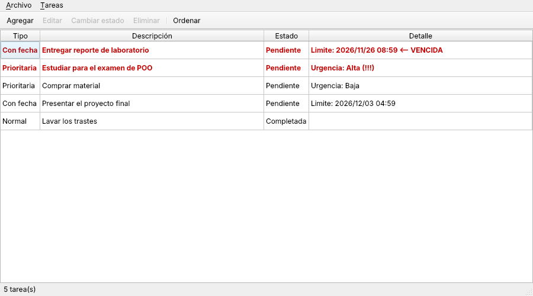
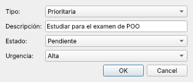

# Lista de tareas

Administrador de tareas en C++. Proyecto de Programación Orientada a Objetos, construido en 3 fases:

| Fase | Qué se hizo |
|---|---|
| 1 | Aplicación de consola con la clase `Tarea` y una lista en memoria. |
| 2 | Herencia, polimorfismo y sobrecarga de operadores: tres tipos de tarea en una jerarquía de clases. |
| **3** | **Aplicación de escritorio con ventanas (Qt), base de datos, excepciones y manejo de archivos.** |



## Fase 3: aplicación de escritorio

### Qué hace

- Muestra en una tabla las tareas de los tres tipos: normal, con fecha límite y prioritaria.
- Permite **agregar**, **editar**, **cambiar el estado**, **eliminar** y **ordenar** tareas desde el menú o la barra de botones.
- Las tareas urgentes (prioridad Alta o fecha vencida) se pintan en rojo.
- **Archivo → Exportar a CSV** guarda la lista en un archivo que se abre en Excel.
- Lleva un **log** (`acciones.log`) con cada acción realizada.
- Si algo sale mal (un dato inválido, una tarea repetida, un archivo que no se puede escribir), avisa con un mensaje y **la aplicación no se cierra**.
- Guarda las tareas en una base de datos SQLite (`tareas.db`), con su tipo y su estado, y las vuelve a cargar al abrir la aplicación: **las tareas no se pierden al cerrarla**.

### Cuadro de diálogo para capturar o editar una tarea

Solo se muestran los campos del tipo elegido: fecha límite para "Con fecha" y urgencia para "Prioritaria".



### Clases nuevas y cómo usan herencia y polimorfismo

| Clase | Hereda de | Qué sobrescribe | Para qué |
|---|---|---|---|
| `VentanaPrincipal` | `QMainWindow` | — | Ventana con la tabla, el menú y la barra de botones. Muestra cualquier tarea llamando a sus métodos virtuales (`tipo()`, `detalle()`, `peso()`), **sin revisar el tipo con if/switch**. |
| `DialogoTarea` | `QDialog` | `accept()` | Captura o edita una tarea. `accept()` valida los datos antes de cerrarse: si la descripción está vacía, avisa y el diálogo sigue abierto. |
| `Aplicacion` | `QApplication` | `notify()` | Atrapa cualquier excepción que se escape de un botón o menú y la muestra en un `QMessageBox` en lugar de cerrar el programa. |
| `ErrorTareas` | `std::runtime_error` | — | Base de las excepciones del proyecto. |
| `ErrorValidacion`, `ErrorBaseDatos`, `ErrorArchivo` | `ErrorTareas` | `titulo()` | Un tipo de error para cada problema; cada uno trae su propio título para el mensaje. |
| `BaseDatos` | — | — | Conexión a SQLite con QtSql: crea la tabla, guarda, actualiza, elimina y carga las tareas. Al cargar, crea el objeto del tipo correcto (`Tarea`, `TareaConFecha` o `TareaPrioritaria`) según la columna `tipo`. |
| `ExportadorCSV`, `RegistroAcciones` | — | — | Exportar a CSV y escribir el log de acciones con `std::ofstream`. |

### Modelo separado de la interfaz

Las clases del modelo (`Tarea`, `TareaConFecha`, `TareaPrioritaria` y `ListaTareas`) ya no leen ni escriben en consola ni crean ventanas. Solo guardan los datos y avisan de los errores lanzando excepciones. Por eso las mismas clases sirven para la versión de consola y para la de ventanas.

En la Fase 3 se les agregó:

- `detalle()` (virtual): el dato propio de cada tipo como texto, por ejemplo `Limite: 2026/12/03 23:59` o `Urgencia: Alta (!!!)`.
- `datoExtra()` (virtual): el mismo dato en forma simple para guardarlo en la base de datos o en el CSV.
- `ListaTareas::obtener(i)`, `editarTarea(i, ...)` y validaciones que lanzan `ErrorValidacion` (descripción vacía, tarea repetida, índice inexistente).

### Manejo de errores

| Situación | Qué pasa |
|---|---|
| Descripción vacía en el diálogo | Mensaje "Dato invalido" y el diálogo no se cierra. |
| Tarea repetida (mismo tipo y descripción) | Mensaje "Dato invalido" y la tarea no se agrega. |
| No se puede escribir el CSV o el log | Mensaje "Error de archivo". |
| No abre la base de datos o falla al guardar | Mensaje "Error de base de datos". Si falla al agregar, la tarea no se queda en la tabla. |
| Cualquier otro error inesperado | Lo atrapa `Aplicacion::notify()` y muestra un mensaje. |

## Librerías usadas

- **C++20** con la biblioteca estándar (`<chrono>`, `<memory>`, `<fstream>`, `<filesystem>`).
- **Qt 6** (probado con Qt 6.4 o más reciente):
  - **Qt Widgets**: ventanas, diálogos, tablas y mensajes.
  - **Qt SQL** con el driver **QSQLITE**: base de datos SQLite. Viene incluido con Qt, no hay que instalar nada más.
- **CMake 3.16** o más reciente para compilar.

## Cómo compilar y ejecutar

### Opción 1: Qt Creator (recomendada)

1. Instala Qt 6 con el [instalador oficial de Qt](https://www.qt.io/download-qt-installer). Selecciona:
   - una versión de Qt 6 con el kit **MinGW 64-bit** (Windows) o el de tu sistema;
   - **Qt Creator**, **CMake** y **Ninja** (en *Developer and Designer Tools*).
2. Abre Qt Creator → **Archivo → Abrir archivo o proyecto** → elige `CMakeLists.txt` de este repositorio.
3. Selecciona el kit de Qt 6 y presiona **Configurar proyecto**.
4. Arriba de la flecha verde, elige el ejecutable **ListaDeTareas**.
5. Presiona **Ejecutar** (Ctrl+R).

### Opción 2: Terminal

**Linux (Ubuntu/Debian):**

```bash
sudo apt install build-essential cmake qt6-base-dev libqt6sql6-sqlite
```

```bash
cmake -S . -B build
```

```bash
cmake --build build
```

```bash
./build/ListaDeTareas
```

**macOS:** instala Qt con `brew install qt cmake` y usa los mismos comandos de `cmake`.

**Windows:** abre la terminal **"Qt 6.x (MinGW 64-bit)"** que se instala con Qt y usa los mismos comandos de `cmake`. Si `cmake` no encuentra Qt, indícale dónde está:

```bash
cmake -S . -B build -DCMAKE_PREFIX_PATH=C:/Qt/6.8.0/mingw_64
```

Para abrir el `.exe` fuera de Qt Creator, primero copia junto a él las DLL de Qt:

```bash
windeployqt build/ListaDeTareas.exe
```

### Versión de consola (Fases 1 y 2)

El mismo `CMakeLists.txt` también compila la versión de consola, `ListaDeTareasConsola`, que usa las mismas clases del modelo. No necesita Qt para funcionar:

```bash
./build/ListaDeTareasConsola
```

### Prueba de la base de datos

`PruebaBaseDatos` guarda tareas de los tres tipos en un archivo temporal, las vuelve a leer y revisa que conserven su tipo, estado, fecha límite, urgencia e id:

```bash
./build/PruebaBaseDatos
```

## Archivos que genera la aplicación

| Archivo | Dónde | Qué contiene |
|---|---|---|
| `acciones.log` | Junto al ejecutable | Una línea por acción: `2026/11/27 14:05 \| Agregar \| [Prioritaria] Estudiar POO` |
| `*.csv` | Donde elijas al exportar | `tipo,descripcion,estado,fecha_creacion,dato_extra,detalle` |
| `tareas.db` | Junto al ejecutable | Base de datos SQLite con las tareas guardadas. Para empezar con la lista vacía, borra este archivo. |

## Archivos del proyecto

| Archivo | Contenido |
|---|---|
| `Tarea.h/.cpp` | Clase base, métodos virtuales y operadores `<`, `==` y `<<`. |
| `TareaConFecha.h/.cpp` | Tarea con fecha límite; detecta si está vencida. |
| `TareaPrioritaria.h/.cpp` | Tarea con urgencia Baja, Media o Alta. |
| `ListaTareas.h/.cpp` | Colección polimórfica (`std::vector<std::unique_ptr<Tarea>>`). |
| `Excepciones.h` | Jerarquía de excepciones del proyecto. |
| `Aplicacion.h/.cpp` | `QApplication` con `notify()` sobrescrito. |
| `VentanaPrincipal.h/.cpp` | Ventana principal (`QMainWindow`). |
| `DialogoTarea.h/.cpp` | Diálogo para capturar o editar una tarea (`QDialog`). |
| `Archivos.h/.cpp` | Exportar a CSV y log de acciones. |
| `BaseDatos.h/.cpp` | Base de datos SQLite (QtSql). |
| `prueba_bd.cpp` | Programa de prueba de la base de datos (`PruebaBaseDatos`). |
| `main.cpp` | Inicio de la aplicación con ventanas. |
| `main_consola.cpp`, `Utilidades.h/.cpp` | Versión de consola. |
| `CMakeLists.txt` | Instrucciones de compilación. |

## Fase 2: herencia, polimorfismo y sobrecarga (resumen)

| Clase | Qué agrega | Peso para ordenar |
|---|---|---|
| `Tarea` (base) | Descripción, estado y fecha de creación. | 0 |
| `TareaConFecha` | Fecha límite; detecta si está vencida. | 3 si está vencida, 1 si no |
| `TareaPrioritaria` | Urgencia Baja / Media / Alta. | 1 / 2 / 3 |

- `operator<` ordena por peso y, si empatan, por la fecha más cercana.
- `operator==` detecta tareas repetidas (mismo tipo y descripción, sin importar mayúsculas).
- `operator<<` imprime cualquier tarea llamando a `mostrar()` de su clase real.

## Equipo

| Integrante | GitHub |
|---|---|
| Ivan | [@WhoisIvann](https://github.com/WhoisIvann) |
| Gerardo | [@GerardoJardinezAlvarez](https://github.com/GerardoJardinezAlvarez) |
| Efrain | [@JaeXx-hub](https://github.com/JaeXx-hub) |
| Augusto | [@jimenez04-py](https://github.com/jimenez04-py) |
